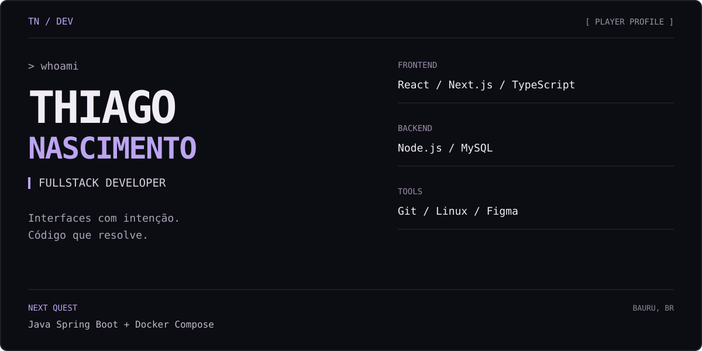

<picture>
  <source media="(max-width: 600px)" srcset="profile-mobile.svg">
  
</picture>

Desenvolvo interfaces, APIs e aplicações web. Gosto de transformar ideias em soluções simples, funcionais e bem estruturadas.

`missões` [Pokédextor](https://github.com/Thiago-Nascimento-2000/Pokedextor) · [Portfólio — código](https://github.com/Thiago-Nascimento-2000/Meu-Portfolio-Thiago-de-Oliveira-Nascimento) · [Autenticação JWT](https://github.com/Thiago-Nascimento-2000/authjwt-backend)

`conectar` [Portfólio](https://portfolio-thiago-de-oliveira-nascimento.vercel.app/) · [E-mail](mailto:thiago.s2nascimentoo@gmail.com)
